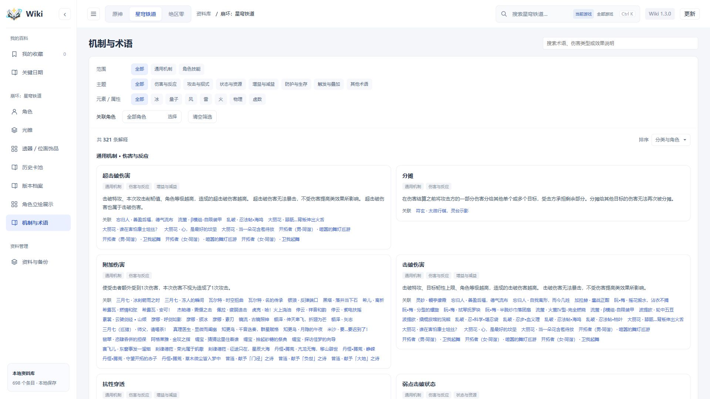
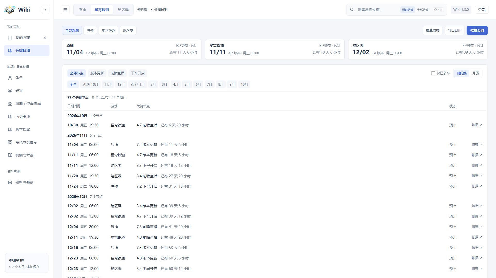
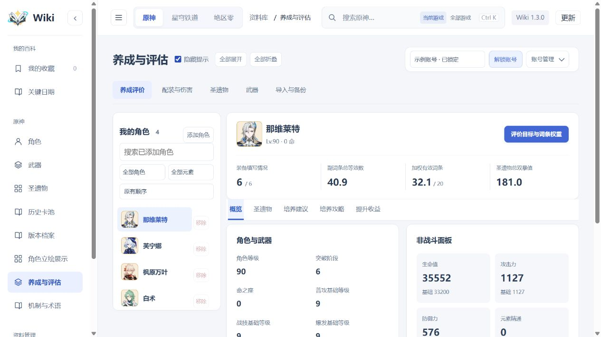
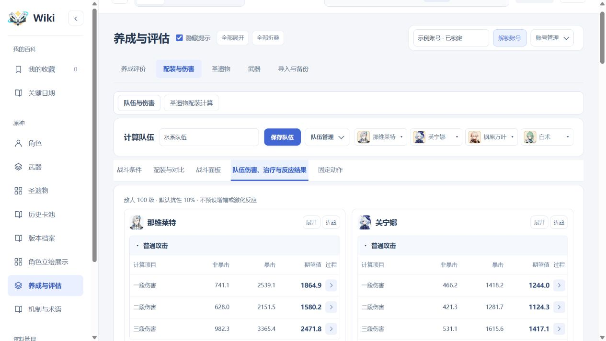
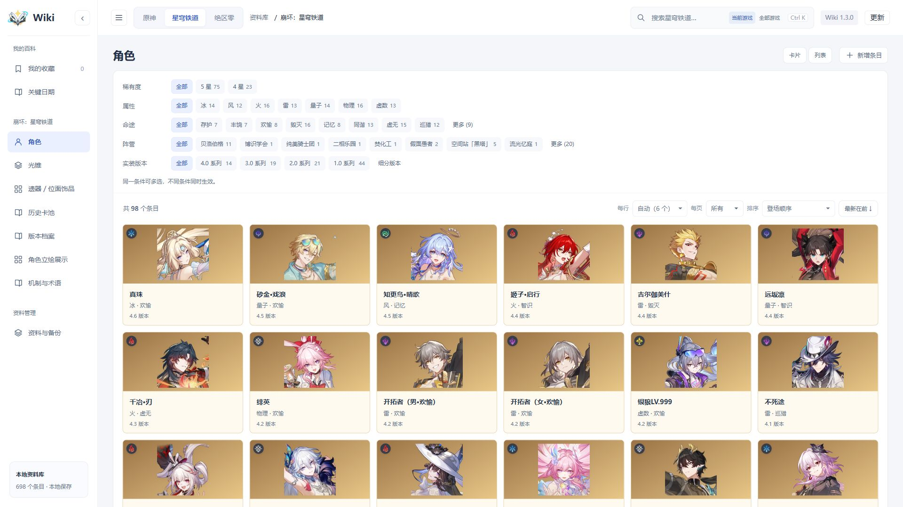
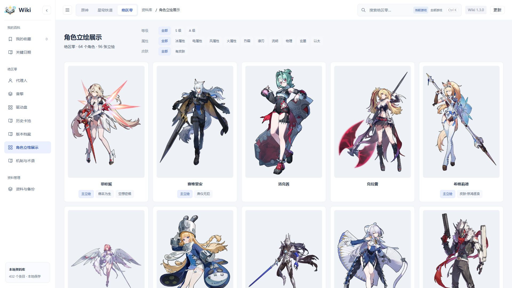
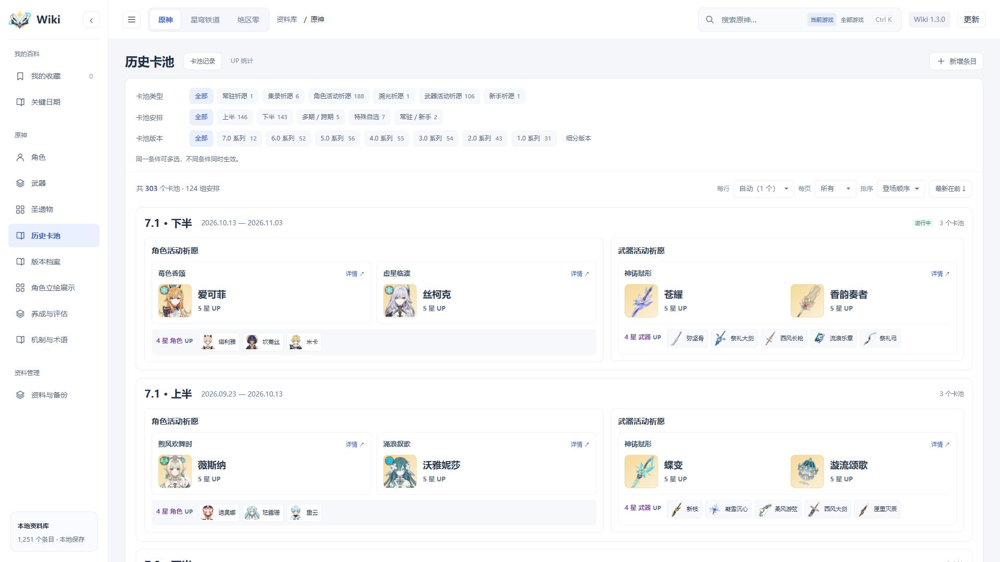
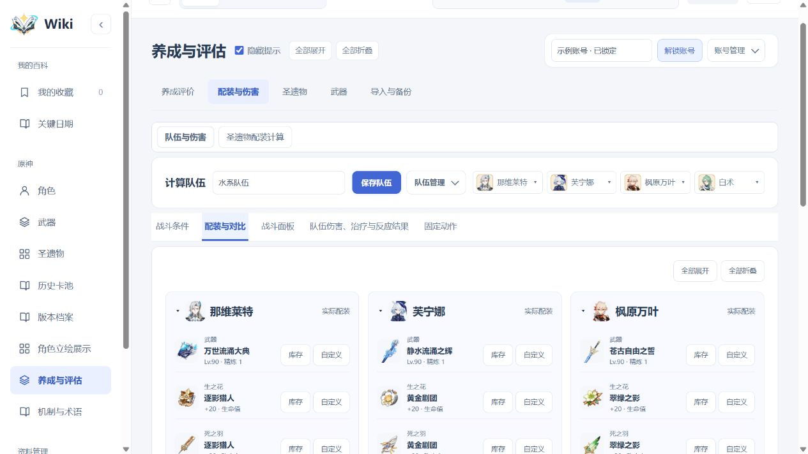

# 原神、星铁、绝区零百科

<a></a>

原神、崩坏：星穹铁道、绝区零的 Windows 本地资料百科。查角色、装备、技能、材料和历史卡池，也能检索机制术语、查看关键日期。

原神另有养成评价、队伍伤害试算、圣遗物配装搜索与强化潜力分析。资料、图片和个人账号保存在本机，日常查阅与计算可离线使用；软件和游戏资料分别更新，下载与安装由用户确认。

**[完整包与软件更新包](https://github.com/yixi646-lang/miyou-wiki/releases/latest)** · **[独立资料包](https://github.com/yixi646-lang/miyou-wiki/releases/tag/wiki-content)** · **[历史版本](https://github.com/yixi646-lang/miyou-wiki/releases)** · **[使用说明](Wiki使用说明.txt)** · **[问题反馈](https://github.com/yixi646-lang/miyou-wiki/issues)**

## 主要功能

- **三游戏资料查阅**：角色、武器、套装、技能、养成材料与获取详情，支持搜索、筛选和收藏。
- **全文搜索与机制术语**：检索技能、命座／星魂／影画、装备效果及已有解释，按主题、关联角色和属性筛选，直接定位并展开目标资料。
- **关键日期**：集中查看版本更新、前瞻直播和下半开启，提供倒计时、月历、推算设置及日历导出；预计节点明确标注。
- **历史卡池与版本档案**：查看卡池记录、UP统计和已收录的重大版本变化，按版本范围整理回坑补课内容。
- **本地立绘展示**：查看角色主立绘、扩展形态与已收录皮肤，按实装版本排序，支持名称、稀有度及元素／属性筛选。
- **原神养成与配装**：角色词条评价、队伍面板与伤害试算、圣遗物配装搜索、理论词条分配，以及强化、重塑和祝圣定义潜力分析。
- **账号与装备管理**：GOOD预览导入、重复扫描装备匹配、多账号与锁定管理、配装方案及压缩备份；便携版附带中文库存扫描器。
- **多页面编辑保护**：发现资料修订冲突时保留草稿，可逐字段选择后明确保存。
- **软件与资料独立更新**：只检查并提醒，确认后下载、安装和重启；也可手动下载，资料更新不增加软件版本号。

## 界面预览

<table>
<tr>
<td width="50%" valign="top"><strong>机制与术语</strong><br><a></a></td>
<td width="50%" valign="top"><strong>关键日期</strong><br><a></a></td>
</tr>
<tr>
<td width="50%" valign="top"><strong>原神养成评价</strong><br><a></a></td>
<td width="50%" valign="top"><strong>原神伤害计算</strong><br><a></a></td>
</tr>
</table>

## 下载与启动

便携版适用于 **Windows x64**，附带 Node.js 运行时，无须另外安装 Node.js、Git 或开发依赖。

1. 打开 [Releases](https://github.com/yixi646-lang/miyou-wiki/releases/latest)，首次使用下载名称含 `Windows-x64` 的完整包。
2. 将压缩包解压到独立文件夹，进入其中的 `Wiki` 目录。
3. 双击 **启动百科.vbs**，浏览器会打开本地 Wiki；`启动百科.cmd` 为兼容入口。

关闭这份 Wiki 的全部页面约 15 秒后，后台服务自动退出。每份目录独立保存资料，可整目录移动。

当前版本为 **1.3.0 / R000011**。已有1.2.1 / R000007、1.2.2 / R000008或R000009、1.2.3 / R000010，可用累计软件更新包直接升级，无须逐个安装中间版本。完整解压更新包，运行其中的“安装更新.vbs”，选择原Wiki目录并等待“更新完成”；不要直接解压覆盖数据库。详细步骤见 [使用说明](Wiki使用说明.txt)。

GitHub 自动生成的 `Source code` 下载项是源码包，不包含便携版运行时和扫描器程序。

## 软件更新与游戏资料

顶栏“更新”分为“软件更新”和“游戏资料”。默认只检查并提醒，可关闭启动检查；下载、安装均需确认，也可前往GitHub手动下载。

**完整包和累计软件更新包都已包含本次公共资料内容，无须再安装同批独立资料包。** 软件更新包内提供自动安装向导，独立资料ZIP另外发布，用于只更新游戏资料、不更换程序。

当前独立资料批次为 **D20261023144921**：

| 已安装的软件 | 安装当前独立资料包 |
| --- | --- |
| 1.2.1 / R000007及更早版本 | 先升级软件；本资料包不支持直接安装 |
| 1.2.2 / R000008、R000009；1.2.3 / R000010 | 下载并完整解压资料包，使用包内“安装资料更新.vbs”手动安装；Wiki内自动安装需先升级软件 |
| 1.3.0 / R000011 | 支持Wiki内自动安装；本批次已随1.3.0软件包提供，无须重复安装 |

本批次包含关键日期数据，旧版内置资料安装器不能处理这类新文件，因此自动安装要求1.3.0；资料包自带的新安装器支持表内列出的旧版本。只装资料不会增加新版栏目和交互功能。

**以后能否在旧版安装，取决于每批资料包的兼容清单，并非一律要求最新软件。** 资料更新保留收藏、库存、养成账号与本地百科编辑；冲突保留本地值并记录。

## 从源码运行

需要 **Node.js 24 或更高版本**。仓库包含本地素材、公开初始化资料和已构建的计算核心，日常运行无须安装第三方 Node.js 依赖。

```powershell
git clone https://github.com/yixi646-lang/miyou-wiki.git
cd miyou-wiki
npm start
```

如需手动管理服务，可运行 `npm run serve`，结束时按 Ctrl+C。浏览器以启动输出的本机地址为准。

主要目录：

| 目录 | 内容 |
| --- | --- |
| `public/`、`shared/`、`lib/` | 界面、共用逻辑和本地服务 |
| `modules/character-assessment/` | 原神养成、伤害计算与配装工具 |
| `assets/` | 本地图片与图标 |
| `data/catalog/`、`data/growth/` | 公开初始化资料及养成数据 |
| `data/versions/`、`data/sources/` | 版本档案与来源快照 |
| `scripts/`、`tests/` | 构建维护脚本与测试 |

计算核心的固定版本与重建方法见 [模块说明](modules/character-assessment/README.md)。中文扫描器的修改源码和构建入口位于 [scripts/scanner-ui](scripts/scanner-ui/README.md)，程序与识别资源随便携版提供。

## 数据与计算范围

百科资料保留固定来源快照；启动时只检查维护者发布的新资料，不静默下载或安装。维护者整理后单独发布内容包，用户确认后更新；不自动抓取未经核查的新游戏资料。已收录最高游戏版本、百科内容覆盖及计算核心支持范围分别记录，以界面资料核查与模块说明为准，不代表对应版本的全部内容均已收齐。

原神计算基于固定提交的 Genshin Optimizer 开发版源码。固定动作合计不等同于完整循环 DPS；有限候选的配装搜索不保证全库存最优；强化潜力中的概率和未知初始档位推导属于估计。计算前可调整目标、队伍条件和参与范围。

个人账号、装备、收藏与备份仅保存在运行目录，不会自动上传到 GitHub。仓库和便携版不包含维护者的个人账号、库存、扫描文件及历史备份；反馈时请勿附带未经处理的个人备份。

## 资料维护与发布

软件版本记录程序功能，游戏资料使用D加UTC时间记录独立批次。仅在资料有实际变化时生成、上传资料包；累计资料以1.2.2 / R000008为基准，只携带新增、变更及跳批次所需的恢复、删除项。实际适用的软件版本以本批次兼容清单为准。

资料单独发布可运行：

~~~powershell
node --disable-warning=ExperimentalWarning scripts/content-release.mjs --upload
~~~

软件和资料同时发布时，使用release-wiki.mjs的 --full --with-content，并提供新版本号与资料说明文件。完整包写入相同资料基准；软件包发布到版本Release，独立资料包发布到wiki-content。确认GitHub上传完成后清理本地ZIP，保留正式快照和发布记录。详细流程见 [版本更新管理指南](docs/版本更新管理指南.md)。

## 反馈

欢迎通过 [Issues](https://github.com/yixi646-lang/miyou-wiki/issues) 提交问题或建议。描述使用版本、操作步骤、预期结果与实际现象即可；涉及计算时补充角色、装备及相关条件，便于复现。

## 来源与第三方许可

本项目为非官方本地工具，与游戏官方无隶属关系。游戏文字、图片和标志的权利归各自权利人所有，资料来源及原始快照在项目中保留。

- [Genshin Optimizer](https://github.com/frzyc/genshin-optimizer)：计算源码使用 MIT 许可，固定提交及其他依赖许可见 [第三方说明](modules/character-assessment/vendor/THIRD_PARTY.md)。
- [Inventory Kamera](https://github.com/taiwenlee/Inventory_Kamera)：中文扫描器基于固定上游源码修改，保留 MIT 许可。
- 便携版中的 Node.js 运行时随附原始许可文件。

各第三方组件按各自许可使用；游戏素材不因第三方代码许可而改变权利归属。

## 更多界面

<table>
<tr>
<td width="50%" valign="top"><strong>角色图鉴</strong><br><a></a></td>
<td width="50%" valign="top"><strong>角色立绘展示</strong><br><a></a></td>
</tr>
<tr>
<td width="50%" valign="top"><strong>历史卡池</strong><br><a></a></td>
<td width="50%" valign="top"><strong>原神队伍配装</strong><br><a></a></td>
</tr>
</table>
